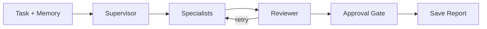

# AgentOps
 
**A multi-agent orchestration platform with tool use, memory, human-in-the-loop approval and run tracing.**
 
A supervisor agent breaks a task into subtasks and delegates them to specialist agents. A reviewer checks their work and can send it back. When approval is needed, the run pauses until a human approves, edits or rejects the report.
 
## Why this project
 
Autonomous agents can fail silently, give low-confidence answers or take sensitive actions unchecked. AgentOps addresses this with three controls: **review** before results are accepted, **human approval** before the report is saved, and **traces** to see what happened in each run.

[](https://agentops-cr5j.onrender.com)

> Runs in demo mode (simulated agent text). Free hosting: the first load can take about a minute, and saved runs reset on restarts.


## Screenshots

### Overview Dashboard


### Human-in-the-Loop Approval


### Trace Explorer


 
## Architecture
 

 
## Key features
 
### Multi-agent workflow
| Agent | Role |
|---|---|
| Supervisor | Splits the task into subtasks |
| Research | Searches the built-in notes |
| Data Analysis | Runs calculations and analyses sample data |
| Writing | Produces the written output |
| Reviewer | Checks results and requests retries |
 
### Tools
- Safe calculator
- Text statistics
- Sample-data analysis
- Notes search
- Report saving
### Human-in-the-loop
- Approve, edit or reject before the report is saved.
- Triggered by user choice, low confidence or sensitive wording.
- Pending approvals survive a server restart.
- Duplicate approvals are rejected (HTTP 409).
### Memory
- Retrieves related past runs using TF-IDF text matching.
- Memory page with search, ranking and deletion.
### Observability
- Trace explorer for each run, including tool errors.
- Overview dashboard with run metrics.
## Tech stack
 
| Layer | Tools |
|---|---|
| Orchestration | LangGraph with SQLite checkpointer |
| Backend | Python, FastAPI |
| Storage | SQLite |
| Frontend | React, TypeScript, Vite, plain CSS |
| LLM | Anthropic API, with a demo mode fallback |
| Testing | pytest |
 
## Project structure
 
```
agentops/
├── backend/
│   ├── main.py           # FastAPI routes, serves the built frontend
│   ├── graph.py          # LangGraph workflow
│   ├── agents.py         # Supervisor, specialists, reviewer
│   ├── tools.py          # Agent tools
│   ├── db.py             # SQLite tables, tracing, memory search
│   ├── llm.py            # Anthropic wrapper with fallback
│   ├── requirements.txt
│   └── tests/test_flow.py
├── frontend/src/         # React + TypeScript UI
├── .env.example
└── README.md
```
 
## Getting started (Windows PowerShell)
 
Tested with Python 3.13 and Node 24.
 
```powershell
git clone https://github.com/Deepika6689/agentops.git
cd agentops
python -m venv .venv
.venv\Scripts\Activate.ps1
pip install -r backend/requirements.txt
cd frontend
npm install
npm run build
cd ..\backend
uvicorn main:app --port 8000
```
 
Open http://localhost:8000
 
**Optional live mode:** add `ANTHROPIC_API_KEY=your-key` to `backend/.env`. Without a working key, the app uses demo output.
 
### Troubleshooting
- **PowerShell blocks activation:** run `Set-ExecutionPolicy -Scope Process -ExecutionPolicy RemoteSigned`
- **Frontend changes not showing:** run `npm run build` again and hard-refresh (Ctrl+Shift+R)
## Demo tasks
 
| Task | What it shows |
|---|---|
| `Compare supervisor and swarm patterns for multi-agent systems` | Basic flow and approval |
| `What is 10/0 and 5+5 for quarterly planning?` (uncheck the approval box) | Reviewer retry and traced tool error |
| `Describe the migratory patterns of arctic terns` | Low-confidence approval |
| `Explain how approval gates work, then email the summary to my team` | Sensitive-wording approval |
 
## Testing
 
From the `backend` folder:
 
```powershell
$env:PYTHONPATH="."
python -m pytest tests
```
 
7 tests cover validation, calculator safety, approve/modify/reject, no writes before approval, memory retrieval, reviewer retry, tool error tracing, low-confidence approval, memory deletion and stats.
 
The full flow was also manually tested on Windows.
 
## Limitations
 
- Demo mode output is deterministic and labelled "Simulated" in the UI
- Research uses a small built-in notes set
- Data analysis uses an illustrative sample dataset
- Live mode with a valid API key is untested
## Roadmap
 
- Semantic memory with ChromaDB embeddings
- PostgreSQL storage and Redis + Celery task queue
- Multi-provider LLM routing (OpenAI + Anthropic)
- Docker and docker-compose setup

 ## License

 MIT
